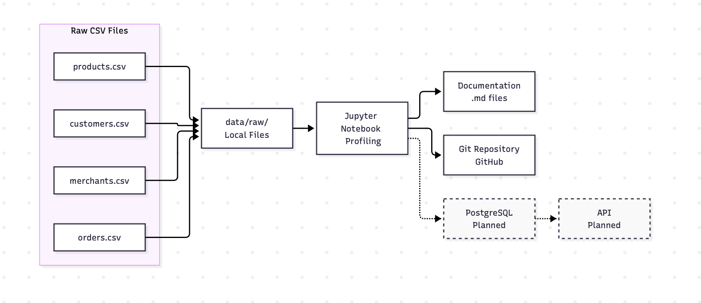

# CityFlow Data Engineering Project

## Предметна область
CityFlow — це сервіс міських замовлень і доставки. Цей проєкт реалізує побудову конвеєра даних для профілювання, обробки, валідації та транзакційного завантаження сирих даних у реляційну базу PostgreSQL.

## Структура проєкту
- `data/raw/` — оригінальні CSV-файли джерел (ігноруються Git).
- `data/sample/` — зразки даних для тестування.
- `docs/` — словник даних, реєстр проблем якості, політика завантаження, архітектурна схема.
- `notebooks/` — Jupyter Notebook з кодом первинного дослідницького аналізу та профілювання.
- `src/` — Python-скрипти для автоматизованого імпорту даних.
- `sql/` — DDL та DML скрипти для створення схем бази даних та трансформації.

## Як запустити
1. Створіть та активуйте віртуальне середовище:
   `python -m venv .venv`
2. Встановіть необхідні залежності:
   `pip install -r requirements.txt`
3. Помістіть вихідні CSV-файли в директорію `data/raw/`
4. Для перегляду аналізу якості даних запустіть `jupyter lab` та відкрийте `notebooks/01_source_profiling.ipynb`.
5. Налаштуйте підключення до бази даних у файлі `src/load_staging.py`.
6. Створіть структуру БД (схеми та таблиці), виконавши DDL-скрипти:
   `psql -d cityflow -f sql/01_schemas_and_stg.sql`
   `psql -d cityflow -f sql/02_core_ddl.sql`
7. Запустіть імпорт сирих даних у проміжну схему Staging:
   `python src/load_staging.py`
8. Виконайте SQL-транзакцію для валідації та завантаження перевірених даних у схему Core:
   `psql -d cityflow -f sql/03_transform_and_load.sql`

## Аналітичний SQL: коректність і продуктивність

Виконуйте скрипти послідовно у тій самій базі cityflow (через psql -v ON_ERROR_STOP=1):

1. psql -d cityflow -v ON_ERROR_STOP=1 -f sql/analyze/00_prepare.sql
2. psql -d cityflow -v ON_ERROR_STOP=1 -f sql/analyze/01_daily_report.sql
3. psql -d cityflow -v ON_ERROR_STOP=1 -f sql/analyze/02_check_daily.sql
4. psql -d cityflow -v ON_ERROR_STOP=1 -f sql/analyze/03_windows.sql
5. psql -d cityflow -v ON_ERROR_STOP=1 -f sql/analyze/04_check_windows.sql
6. psql -d cityflow -v ON_ERROR_STOP=1 -f sql/analyze/05_bench_prepare.sql
### Вимірювання без індексу (1 прогрів + 3 контрольні запуски -> docs/analyze/plan_before.txt):
psql -d cityflow -v ON_ERROR_STOP=1 -f sql/analyze/06_bench_query.sql
### Створення індексу idx_lab03_cf_bench_merchant_created (merchant_id, created_at):
psql -d cityflow -v ON_ERROR_STOP=1 -f sql/analyze/07_bench_index.sql
### Вимірювання з індексом (1 прогрів + 3 контрольні запуски -> docs/analyze/plan_after.txt):
psql -d cityflow -v ON_ERROR_STOP=1 -f sql/analyze/06_bench_query.sql
### Перевірка незмінності результату:
psql -d cityflow -v ON_ERROR_STOP=1 -f sql/analyze/08_bench_check.sql

## Ключові висновки по проєкту

Якість даних та транзакційність: Вхідні файли містили дублікати первинних ключів, пропущені контакти та невалідні дати створення замовлень. Завдяки розмежуванню stg і core та атомарній транзакції BEGIN ... COMMIT до core потрапили виключно валідовані узгоджені записи.

Контроль Grain та уникнення fan-out при JOIN: Пряме з'єднання orders із order_items множить суму замовлення total_amount на кількість позицій у чеку. Попередня агрегація позицій у CTE items_by_order (GROUP BY order_id) перед LEFT JOIN гарантує співвідношення 1:1 і повну збіжність сум зі звіркою (difference_rows = 0, PASS).

Віконні функції та індексація: Віконні конструкції SUM(...) OVER та ROW_NUMBER() OVER дозволяють обчислювати накопичувальні суми та знаходити останнє замовлення клієнта без втрати деталізації рядків. Дослідження багатоколонкового індексу (merchant_id, created_at) за допомогою EXPLAIN (ANALYZE, BUFFERS) показало перехід від послідовного сканування до індексного доступу зі збереженням 100% ідентичності вихідного набору даних.

## Архітектура (v0)
